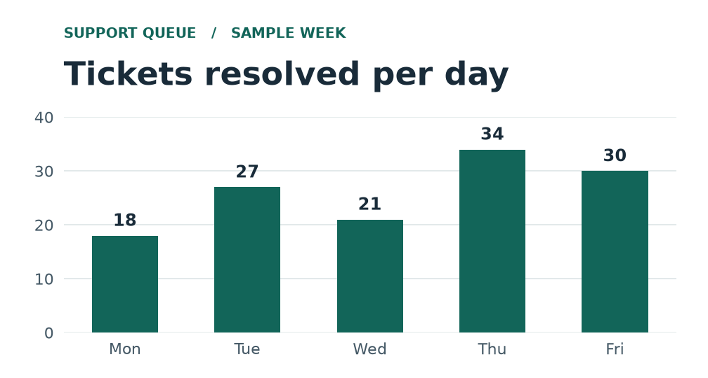

# a2ui-discord

Turn [A2UI 1.0](https://a2ui.org/specification/v1.0-a2ui/) JSON into interactive Discord messages in Python or TypeScript. For example, a reader can switch a chart from bars to a line with a dropdown, without leaving the message.

Use `DiscordView` to render a live A2UI surface, or `Surface` for a small card you can restore from JSON. Both produce native [Discord components](https://docs.discord.com/developers/components/reference). Your bot owns transport, permissions, and actions. Neither package needs a Discord SDK.

| Package | Runtime | Install from this checkout |
|---|---|---|
| [Python](python/README.md) | Python 3.11+ | `python -m pip install './python[protocol]'` for `DiscordView`; omit the extra for `Surface`. |
| [TypeScript / JavaScript](typescript/README.md) | Node.js 22+ | Run `npm ci` and `npm pack` in `typescript/`. Install the `.tgz` in your app. For `a2ui-discord/view` (ESM), also install `@a2ui/web_core@0.16.1`. |

## Live A2UI 1.0 surfaces

`DiscordView` maps **all 18 component types** in the [1.0 Basic Catalog](https://a2ui.org/specification/v1_0/catalogs/basic/catalog.json) to Discord. It mounts an official SDK surface instead of implementing a second protocol engine. The SDK processes ordered creates, component and model updates, deletes, scoped templates, function calls, checks, metadata, and RPC. Multiple surfaces can share one processor. Mount one view per Discord message.

| Basic component | Discord behavior |
|---|---|
| `Text`, `Icon`, `Divider` | Discord Markdown, a text label for an icon, and a horizontal separator. |
| `Row`, `Column`, `List`, `Card` | Preserve reading order. Pack adjacent buttons in rows of five. Group card contents in Discord containers. Paginate oversized surfaces. |
| `Tabs`, `Modal` | Select a tab, or open a separate page in the same message and close it to return. A button trigger also dispatches its action. Only visible, enabled controls can act. |
| `Image`, `Video`, `AudioPlayer` | Image/video gallery; audio attachment or HTTPS link. The bot supplies attachment bytes. Playback depends on Discord and the media format. |
| `Button`, `CheckBox` | Dispatch a bound action or toggle a writable boolean. Failing checks disable action buttons. A Basic `openUrl` action with a literal or path-bound HTTPS URL becomes a link. |
| `ChoicePicker` | Single or multiple selection, clearing, and optional filtering. Large lists split into menus of 25. A multi-select keeps selections outside the edited menu. |
| `TextField`, `Slider`, `DateTimeInput` | Open a Discord form. On submit, write a string, bounded number, or ISO date/time. Numeric steps and date/time ranges are checked. Read-only bindings cannot be edited. |

See the [Python](python/README.md#mount-a-live-surface) and [JavaScript](typescript/README.md#mount-a-live-surface) examples. The [studio fixture](conformance/studio.json) exercises the catalog with synthetic data.

**Native Discord limits:** This is component coverage, not identical browser behavior or a certification of protocol conformance. Discord controls layout, media sizing, icons, accessibility announcements, and playback. The view cannot apply weights, alignment, custom SVG paths, video posters, arbitrary styling, or ARIA `hidden`/`live`. Accessibility labels name controls; image descriptions become alt text. Sliders and date/time pickers use text entry, not drag or calendar controls. Edits and filters apply on submit, not per keystroke. Secure fields are disabled; never put secrets in a shared model. Links and media use the [URL rules below](#chart-example), not arbitrary URIs. Uploads, Activity/web UI, v0.x, and arbitrary custom component behavior are outside the built-in mappings. For a registered custom catalog, a trusted `custom_text` / `customText` callback can return a text projection of a resolved node.

Keep the mounted view in memory. After each accepted update or settled RPC, call `message()` and send the edit if the payload changed. `await view.interact(verified_data)` returns an entire Discord type `7` update or type `9` form response. A type `9` must be the initial reply, not a follow-up to a deferral. On delete, retire the Discord message or controls and call `dispose()`. On restart, replay trusted protocol state, mount a new view, and replace old controls. A shared message has one tab, filter and page for all authorized readers. For private editing, use a separate surface and message per reader.

## Supported subset

The following contract applies only to the dependency-free `Surface` API. It keeps the beta 3 snapshot format and atomic validation rules.

| Input | Behavior |
|---|---|
| `createSurface` | One complete basic-catalog tree rooted at `root`. Each mounted component occurs once. |
| `updateComponents` | Add or replace definitions by ID. Only controls reachable from `root` can act. |
| `updateDataModel` | Replace the root object or write at an absolute model path. `null` deletes the leaf; deleting an array element shifts later elements left. |
| `Column`, `Text` | Explicit ordered children and Discord Markdown text. Mention notifications are off. |
| `Image` | Render one item in a [Discord media gallery](https://docs.discord.com/developers/components/reference#media-gallery). `url` and optional `description` (1–1,024 characters of alt text) accept literal strings or bindings. `fit`, `variant` and `weight` are unsupported. |
| `Row`, `Divider` | A row contains 1–5 buttons or exactly one picker. A divider renders a horizontal separator. Vertical dividers and row styling are unsupported. |
| `ChoicePicker` | 1–25 distinct string options. Select one by default, or several with `variant: "multipleSelection"`. The optional label becomes a placeholder. Bind to an existing list. A click supplies at least one choice; set the model to `[]` to clear it. |
| `Button` | A `Text` child supplies the label. An omitted or `default` variant becomes secondary; `primary` becomes primary. `action.event` requires `name`. Optional `context` and `userMessage` resolve on click. |

Pass decoded JSON objects. Bind text, labels, picker values and action context with absolute [JSON Pointers](https://www.rfc-editor.org/rfc/rfc6901), e.g. `{"@path":"/findings/0/tags"}`. `/` is the model root. Escape `~` as `~0` and `/` as `~1` in keys. Parent objects and array slots must exist; writes may create a final object key. Array indices are zero-based decimal numbers without leading zeros. Relative paths, appends and automatic parent creation are unsupported.

Each action context value can be a string, number, boolean, array, plain object, or binding. Literal array/object contents are not evaluated. Top-level `@` keys in object literals are reserved. For portable snapshots, use strings for identifiers and for integers outside JavaScript's safe integer range.

Creates, updates and selections validate the mounted tree. Invalid input raises `SurfaceError`; failed updates and selections leave the previous card intact. Each message allows 40 Discord components including rows and container, and 4,000 total text-display characters. Templates, checks, RPC, `deleteSurface`, and incomplete streamed trees are not supported.

## Chart example

The [sample surface](examples/charts/surface.json) displays the same fictional ticket counts as a bar or line chart. The picker writes to `/view`; `Image.url` reads `/view/0`. Selecting **Line chart** changes the image without a chart-specific component or handler. Both images have the same alt text because they show the same values.



With either package installed, run the matching snippet where `examples/charts/` is available:

```python
import json
from pathlib import Path
from a2ui_discord import Surface

card = Surface(json.loads(Path('examples/charts/surface.json').read_text()))
initial = card.message()  # Send with bars.png.
card.interact({'custom_id': 'a2ui:style', 'component_type': 3, 'values': ['attachment://line.png']})
edit = {'type': 7, 'data': card.message()}  # Respond with line.png.
```

```js
import { readFileSync } from 'node:fs';
import { Surface } from 'a2ui-discord';

const card = new Surface(JSON.parse(readFileSync('examples/charts/surface.json', 'utf8')));
const initial = card.message(); // Send with bars.png.
card.interact({ custom_id: 'a2ui:style', component_type: 3, values: ['attachment://line.png'] });
const edit = { type: 7, data: card.message() }; // Respond with line.png.
```

For an attachment, the bot supplies the bytes. In this example, send `bars.png` with the initial message. On the edit, upload `line.png` instead. Use [Discord multipart uploads](https://docs.discord.com/developers/reference#uploading-files): add `attachments: [{"id":0,"filename":"line.png"}]` to the edit's `data`, and send that PNG as `files[0]` alongside `payload_json`. The [two PNGs](examples/charts/) are ready to use. Matplotlib is optional and only needed to regenerate them.

For a hosted image, use a direct `https://` URL instead; no attachment is needed. This subset accepts ASCII DNS-style hosts without credentials or explicit ports. Percent-encode spaces and non-ASCII path or query characters. An `attachment://` name uses only ASCII letters, digits, `_`, `-` and `.` and cannot start with a dot. The renderer does not fetch URLs, read files, or verify the image format. Allow only trusted media sources and map attachment names to files the bot may share.

## Connect a bot

1. Construct a `Surface` from the envelope. Send `message()` to Discord. Store `snapshot()` with the returned message and channel IDs.
2. Verify the interaction, authorize the actor, and route it to that specific message. Restore with `Surface(saved)` in Python or `new Surface(saved)` in TypeScript.
3. Pass the raw Discord interaction's `data` object to `interact()`. A picker changes the model and returns `None` / `null`. A button returns an A2UI action. Dispatch only allowed actions.
4. For a local edit, acknowledge with `{"type":7,"data": ...}` using the new `message()`. For slow work, defer within Discord's three-second window. Serialize edits per message and save accepted changes. Control IDs are not credentials and do not encode a revision.

See the [security guidance](SECURITY.md), [shared JSON test cases](conformance/cases.json), [release checks](CONTRIBUTING.md), and [changelog](CHANGELOG.md). This project is independent of Discord and A2UI.
